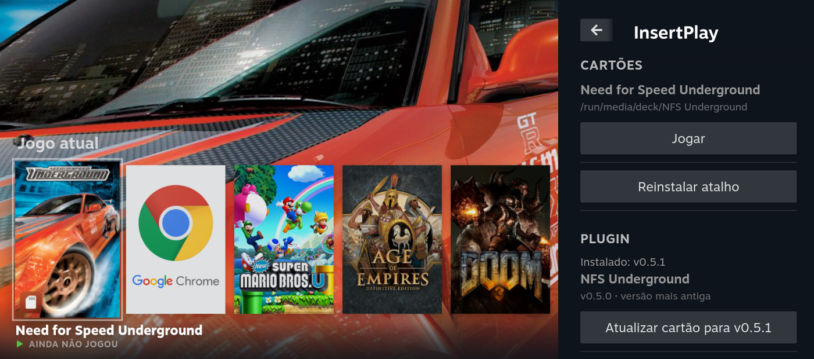

# InsertPlay

A [Decky Loader](https://decky.xyz/) plugin that turns SD cards into game cartridges on SteamOS (Steam Deck, Steam Machine).

- **Insert an InsertPlay card** and its game shows up in the Steam library with the card's own artwork, and starts. **Remove the card** and the shortcut is hidden.
- **SD card badge** on the covers of every game on the inserted card: InsertPlay shortcuts and Steam games installed in a library on the card.
- **Steam games on a card**: a card with a Steam library and no InsertPlay manifest also gets a notification when inserted and removed and, with "Iniciar ao inserir" on, starts its game if the card has exactly one and no other game is running.
- **Portable saves**: Steam games installed on a card can keep their saves on the card, so they follow it to another device.
- No Steam restart needed for any of this.

> The plugin UI is in Brazilian Portuguese for now. Translation is tracked in [#21](https://github.com/insert-play/insertplay/issues/21). This README gives each UI label in Portuguese with its meaning.

## Install

InsertPlay is not on the Decky store. You install it from a release or from a card, through Decky's developer options. Decky Loader itself must already be installed.

1. In Game Mode, press `…` → Decky icon → gear → **General**: turn on **Developer mode** (once).
2. Decky settings → **Developer**, then one of:
   - **Install Plugin from URL**: `https://github.com/insert-play/insertplay/releases/latest/download/InsertPlay.zip`; or
   - **Install Plugin from ZIP File** → **Browse**: pick `InsertPlay.zip`, downloaded from the [releases](https://github.com/insert-play/insertplay/releases) or carried by a card. On a card it is in `insertplay/decky/`. In the file picker, press **↑** until `/`, then go to `run` → `media` → `deck` → `<card label>` → `insertplay` → `decky`.
3. Accept the third-party plugin warning and confirm.

InsertPlay shows up in the Decky menu (Quick Access).

A script on the card that installs Decky and the plugin in one step is tracked in [#20](https://github.com/insert-play/insertplay/issues/20).

## Update from a card

A card can carry the plugin at `insertplay/decky/InsertPlay.zip`. The panel's **Plugin** section shows the installed version and, for each inserted card, the version it carries:

| The card has | Button | What happens |
|---|---|---|
| a newer version | Atualizar plugin para vX (update plugin) | Decky asks for confirmation and replaces the plugin with the card's version. |
| the same version | Reinstalar plugin do cartão (reinstall) | Same as above, same version. |
| an older version or an invalid zip | Atualizar cartão para vX (update card) | Asks for confirmation and writes the installed version to the card. |
| no package | Gravar plugin vX no cartão (write to card) | Writes the installed version to the card. |

Inserting a card with a newer version shows a notification. The plugin never updates itself. The link between cards and shortcuts (`~/homebrew/settings/InsertPlay`) survives updates. If you had hidden or reordered InsertPlay in Decky's list, that goes back to the default, as with a store update.

## Make a card

Cards are prepared by hand for now: a manifest, a guid and a launch script at the card root. See **[docs/card-format.md](docs/card-format.md)** and start from [`card-template/`](card-template/). The plugin never writes the manifest or the guid; a card without `shortcut-identity.json` is refused with a message in the panel.

## Panel settings

- **Iniciar ao inserir** (start on insert): starts the card's game when the card is inserted.
- **Ocultar ao remover o cartão** (hide when the card is removed): hides the shortcut while its card is out.
- **Eventos** (events): what the plugin did recently. The same log is in `~/homebrew/data/InsertPlay/events.jsonl`.

## Portable saves (Steam games on a card)

In Game Mode, Steam keeps the Proton prefix (where many games save) on the internal drive, even for a game installed on a card. A game without Steam Cloud, or with Cloud broken on SteamOS, leaves its save on the device. **Portable saves** move that data to the card and, while the card is inserted, link the internal drive to it with a symlink.

The panel's **Save portátil** section has one choice per card with Steam games. It applies to every game on the card and only shows up while such a card is inserted:

| Mode | Moved to the card | Stays on the device |
|---|---|---|
| **Desligado** (off, default) | nothing | everything |
| **Saves** | `pfx/drive_c/users/steamuser` (Documents, AppData, Saved Games), in `.insertplay/users/<appid>/` | the rest of the prefix, with `steamuser` turned into a link |
| **Prefixo completo** (full prefix) | the whole `compatdata/<appid>`, in `.insertplay/prefixes/<appid>` | just the link |

- **Use "Saves".** Proton copies ~115 MB of DLLs into the prefix **on every launch**. With the full prefix on a slow card, such as an old SDHC at 0.4 MB/s, each launch took minutes. In "Saves" mode that copy stays on the internal drive.
  - "Saves" doesn't carry what the game writes to the Windows registry (`user.reg`), which is rare for saves. In exchange, graphics settings kept in the registry stay per device. Measured with Bully: the Deck's saves loaded on the Steam Machine, and the resolution stayed each device's own (800p on the Deck, 4K on the Machine). A game that keeps its settings in `Documents` or `AppData` takes them along.
  - "Prefixo completo" carries the registry, but is only usable on a fast card (A1/A2).
- **The choice is stored on the card** (`.insertplay/portable-saves.json`). On another device with the plugin, the links are recreated on insert without choosing again.
- **A game that never ran on that device**, in "Saves" mode: the plugin creates just the path down to `users/` with the link. Proton builds the rest around it, and the save is there on the first launch.
- **The card must be ext4** (Steam's "Format"). On exFAT/NTFS the choice is disabled.
- **Launch options with `STEAM_COMPAT_DATA_PATH` or `WINEPREFIX`** make Proton use another prefix and ignore the link. The plugin warns with a notification but doesn't remove them. They are stored per device: remove them on each one.
- **More than one candidate for the same game** (internal drive, card, the copy a move leaves in `steamapps/compatdata`): the one with the most recent user files wins. A folder with no user files (just created by Steam) never beats one with a save.
  - The others become backups and are never deleted: on the internal drive, `<path>.insertplay-backup-<date>`; on the card, `.insertplay/backups/`.
  - If the loser had a save, a notification says so.
- **Running game**: the plugin leaves it alone. The pass runs every 30 s and on every library change, before "Iniciar ao inserir".
- **Leaving a mode** (turning it off, or switching modes) copies what is on the card back to the internal drive. The card's copy stays.
- **Game moved off the card**: the link becomes a copy on the internal drive.
- **Game uninstalled**: only the link goes away.
- **Card removed**: the broken link is deleted on the next pass.
- **A device with a plugin older than 0.5.0** ignores `.insertplay` and uses its own prefix. After updating, the most-recent rule applies.
- **Out of scope**: the shader cache (`shadercache/<appid>`), which stays on the device, and InsertPlay cards (non-Steam shortcuts), whose launch script already keeps the prefix on the card.

## Achievements (RetroAchievements)

A card whose manifest declares the game's [RetroAchievements](https://retroachievements.org) ID (`game.retroAchievements.gameId`, see [docs/card-format.md](docs/card-format.md#game)) shows its achievements in Steam's own screens: the **Conquistas** section of the game page and the "Minhas conquistas / Conquistas globais" list.

- **The plugin only shows progress.** Unlocking stays with the emulator (PCSX2, DuckStation and Dolphin have RetroAchievements built in and show their own pop-up during the game). Log in to RetroAchievements in each emulator on your own: the plugin never reads or writes the emulators' credentials.
- **Login**: panel section **Conquistas**, with your RetroAchievements user and **Web API Key** (retroachievements.org → Settings → Keys). **Abrir página da chave** (open the key page) opens that page in Steam's own browser, also in Game Mode: copy the key there, go back to the panel and paste it. A Web API key, not your password: it can only read the API, and you can regenerate it without touching your password or the emulators' login. The key is used only to read the API and is stored in `~/homebrew/settings/InsertPlay/ra_credentials.json`, readable only by your user. It never goes to a log.
- **When it updates**: when you open the game page or its achievement list (at most once a minute per game, also from the Steam menu with the game running), on card insertion, at Steam startup (from the cache), when the card's game closes, and with **Atualizar agora** (update now).
- **Offline**: the last fetch of each game is cached in `~/homebrew/data/InsertPlay/ra-cache/`. The page of a removed card keeps showing it. Badge images come from `media.retroachievements.org` and need the network.
- Hardcore and softcore unlocks both count. Subsets (a separate RetroAchievements game with a `ParentGameID`) are not shown.

## How it works

- `main.py` + `py_modules/insertplay_decky/` (Python backend):
  - scans `/run/media/*` and `/run/media/*/*` every second;
  - reads `steam-shortcut.json` and `shortcut-identity.json` without writing to the card;
  - tells the frontend with `card_inserted` and `card_removed`;
  - copies the shortcut icon to the device (`~/homebrew/data/InsertPlay/icons/`): Steam stores only the path, and an icon on the card would vanish with the card (#17).
- `src/` (frontend, runs inside Steam):
  - creates or updates the shortcut with `SteamClient.Apps.*`;
  - applies the artwork and the icon (never replacing an icon picked by the user), hides and shows the shortcut, and starts the game;
  - draws the SD card badge on library covers (`src/steam-badges.tsx`, depends on Steam's DOM);
  - shows RetroAchievements progress in Steam's achievement screens (`src/achievements.ts`, patches Steam's internal stores).
- Registry `guid → appid` in `~/homebrew/settings/InsertPlay/registry.json`.

The plugin relies on undocumented Steam client APIs (`SteamClient.*`); the calls in use and how they were measured are in [docs/steam-api-notes.md](docs/steam-api-notes.md). A Steam update can break them.

## Known limitations

- The shortcut registry is per device, but shortcuts are per Steam account: with two accounts on one device, a card can get a shortcut in each ([#8](https://github.com/insert-play/insertplay/issues/8)).
- Steam's home screen doesn't refresh when a card is inserted or removed ([#5](https://github.com/insert-play/insertplay/issues/5)).
- Steam sometimes doesn't read the games of a freshly mounted card ([#15](https://github.com/insert-play/insertplay/issues/15)).

## Development

See [docs/development.md](docs/development.md).

## License

[BSD-3-Clause](LICENSE). Parts are adapted from [decky-nonsteam-sync](https://github.com/JoseArkadio/decky-nonsteam-sync); see [NOTICE](NOTICE).
